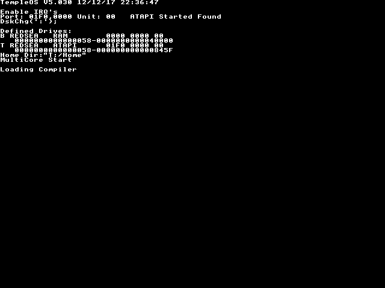

# templeos-recomp

TempleOS, statically recompiled: the operating system running as an ordinary
program on Windows, Linux and macOS, with no emulator and no virtual machine.

TempleOS is a complete 64-bit operating system written by one person. Its
kernel, its language (HolyC) and that language's compiler, its document format
and editor, its window manager, 2D and 3D graphics, sound, games and the
documentation for all of it were designed and written by Terry A. Davis over
more than a decade. This project takes the system exactly as he shipped it in
its final release, V5.03, and translates its machine code to C so that it can
keep running on modern machines.

*The lifted kernel's first screen: KMain's boot text, the CD found through the
emulated ATAPI drive, and the compiler about to load. The same screen from the
Linux build is in `docs/screenshots/linux-first-light.png`.*

## Credit

TempleOS was written by **Terry A. Davis (1969–2018)**. He placed it in the
public domain. The final release, V5.03, is preserved at
[templeos.org](https://templeos.org/) and in the
[Internet Archive](https://archive.org/search?query=TempleOS); its source is
part of the disc itself.

Everything that runs here is his code. This repository adds only the
translation and a model of the PC it expects; it contains none of TempleOS
itself, and you supply the ISO.

## How it works

TempleOS boots from a CD into 64-bit long mode, runs everything in ring 0 in
one identity-mapped address space, and compiles most of itself from HolyC
source while it boots. The project handles that in three parts:

1. **The kernel** (`0000Kernel.BIN.C` on the disc) is lifted to C by
   [pcrecomp](https://github.com/sp00nznet/pcrecomp)'s `lift64_sys`, an x86-64
   lifter for operating-system code: port I/O, interrupts, MSRs, descriptor
   tables, IRETQ, the x87 FPU. The 16- and 32-bit start-up, which talks to the
   BIOS, is reproduced in C.
2. **The machine** is a small model in C: timer and interrupt controllers, the
   keyboard and mouse controller, the CMOS clock, VGA (into an SDL2 window), an
   ATAPI CD-ROM that serves your ISO read-only, and an HPET.
3. **Code made at run time** (`Compiler.BIN`, and everything the HolyC compiler
   produces) is captured when it first appears, lifted, and checked byte for
   byte before its lifted form is used. New code that was never captured stops
   the run with a message; nothing is ever interpreted or executed from guest
   memory.

The details, with diagrams, are in [docs/architecture.md](docs/architecture.md);
the reasoning is in [docs/survey.md](docs/survey.md).

## Status

| Stage | State |
|---|---|
| ISO read (RedSea, TempleOS compression) | done |
| Kernel lifted and booting: KMain, memory, interrupts, timer, drive detection | done - boot text on screen |
| `Load("Compiler")`: the HolyC compiler, captured and lifted | done - verified byte for byte on Windows and Linux |
| StartOS: the compiler's output, captured and lifted as it boots | in progress - compiling the kernel and compiler headers, lifted |
| Adam, the window manager, the shell | next |
| Keyboard, mouse, editor, a demo or game from the disc | planned |
| Sound (PC speaker) | planned (muted for now) |
| Builds | Windows (MSVC, Visual Studio 2022) and Linux (gcc, tested on Debian under WSL); macOS through the same CMake, not yet built |

## Getting started

You need TempleOS V5.03's `TempleOS.ISO`, Python 3.10+ with `capstone`
(`pip install capstone`), CMake, a C compiler and SDL2, and a checkout of
pcrecomp's `temple` branch next to this folder (`../pcrecomp-temple`, or set
`PCRECOMP`).

**Windows:** double-click `Setup.cmd`. It checks the tools, asks for the ISO,
lifts, builds the capture cache (hidden, muted runs), and leaves
`TempleOS.cmd` to start it.

**Linux / macOS:** `./setup.sh /path/to/TempleOS.ISO`.

By hand:

    python tools/gen.py TempleOS.ISO                       # lift into src/gen/
    cmake -S . -B build -DCMAKE_TOOLCHAIN_FILE=<vcpkg>/scripts/buildsystems/vcpkg.cmake
    python tools/capture.py TempleOS.ISO                   # lift, build, run hidden, repeat
    build/Release/templeos TempleOS.ISO                    # then run it

Options: `--hidden` (no window), `--shot out.png SECONDS`, `--quit SECONDS`,
`--trace`. `TEMPLE_TRACE_FN=<hex address>` logs calls to one guest function.

## Layout

| Path | What |
|---|---|
| `runtime/` | the host side: boot (`main.c`), CPU system calls and interrupts (`machine.c`), task switches (`tasks.c`), devices (`devices.c`), the window and PNG writer (`present.c`), dispatch and capture |
| `tools/` | ISO readers (`redsea.py`, `tosz.py`, `extract.py`), `.BIN` modules (`tosbin.py`), function discovery, the generator (`gen.py`) and the capture loop (`capture.py`) |
| `docs/` | the survey, the architecture, screenshots |
| `src/gen/`, `work/` | generated from your ISO; not in the repository |

## License

The code in this repository is MIT licensed (see `LICENSE`). TempleOS itself is
in the public domain and is not distributed here.
